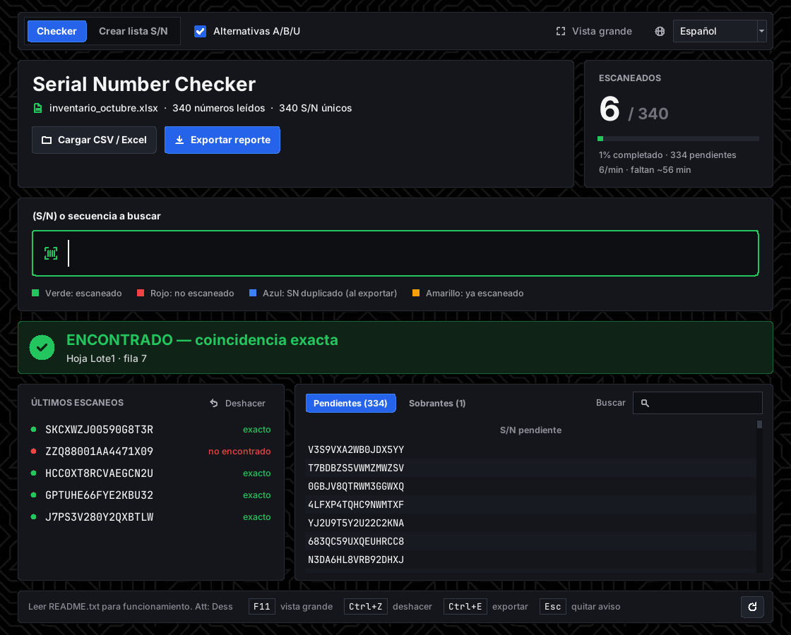
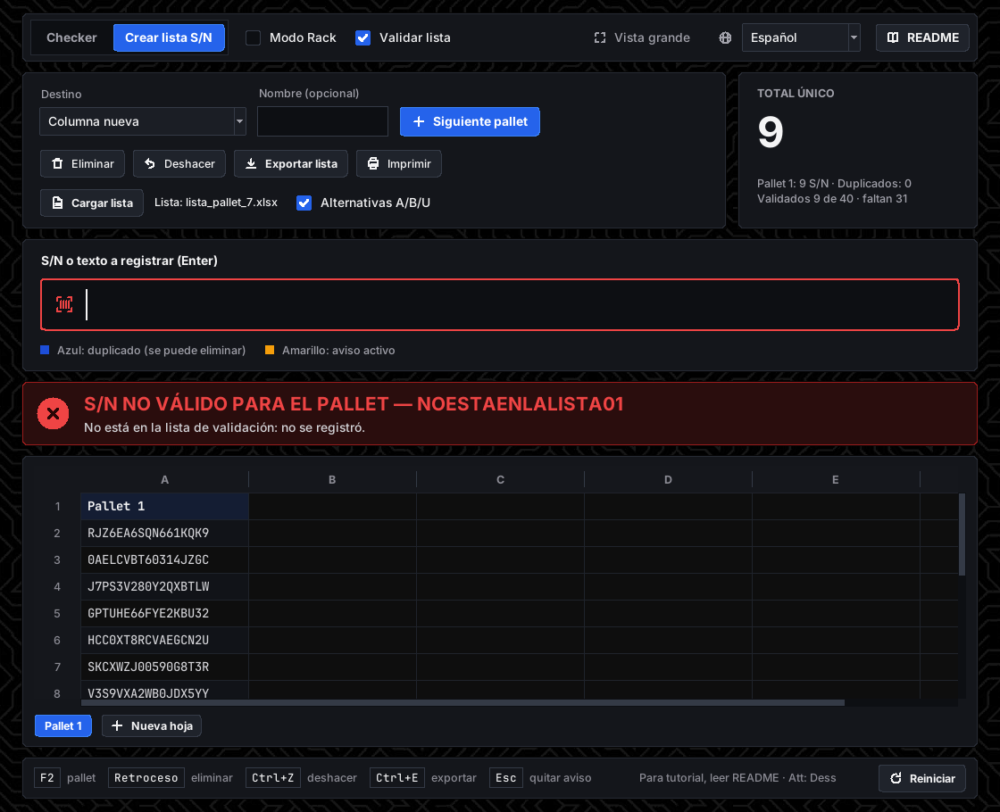
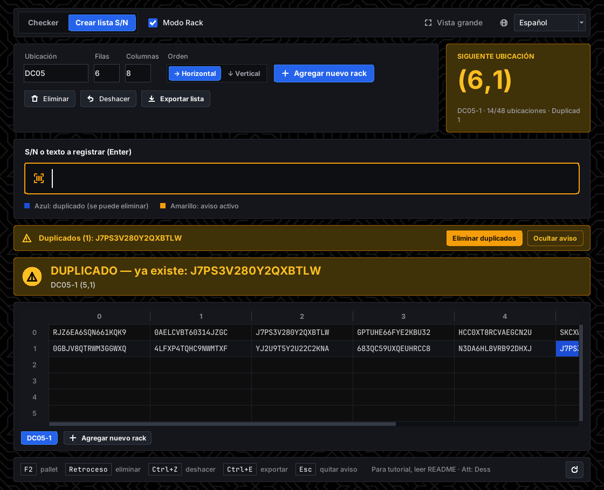

# Serial Number Checker

**Creador:** Desblack "Dess"

Aplicación de escritorio para Windows que comprueba números de serie (S/N) escaneados contra una lista en CSV o Excel, y que también arma listas nuevas por pallets o por ubicaciones de rack. Interfaz en español, inglés y portugués.



## Descarga

Descarga la última versión en **[Releases](https://github.com/Desblackve/serial-number-checker/releases)**. Descomprime la carpeta completa y abre `SerialNumberChecker.exe` sin separarlo de la carpeta `_internal`. No necesita instalar Python.

Si Windows muestra "Windows protegió su PC", pulsa "Más información" y luego "Ejecutar de todas formas". Aparece porque el programa no está firmado digitalmente.

## Qué hace

**Checker**
- Carga un CSV o Excel y reconoce las columnas de S/N por su encabezado (S/N, Serial Number, Nº de serie…).
- Comprueba cada lectura: verde si lo encuentra, amarillo si ya estaba escaneado, rojo si no está en la lista.
- Sobrantes, deshacer (Ctrl+Z), pegar varios S/N a la vez, buscador y vista grande (F11).
- Muestra el progreso, el ritmo por minuto y el tiempo estimado.
- Copia un S/N pendiente con Ctrl+C o con clic derecho.
- Exporta un reporte Excel coloreado con las hojas Resumen, Escaneos y Sobrantes, y permite reanudarlo después. Las columnas salen con el ancho justo para cada S/N.

**Crear lista S/N**
- Arma una lista por pallets, en columnas o en hojas, y la exporta a Excel o CSV. Las hojas se renombran con doble clic en su pestaña.
- **Validar lista:** carga la lista de S/N esperados y solo deja registrar los que están en ella; los demás se avisan en rojo.
- **Modo Rack:** guía el escaneo ubicación por ubicación (x,y) en racks configurables (DC05-1, DC05-2…).
- Columnas que se pueden estirar, duplicados marcados en azul e impresión con Ctrl+P.





## Guía completa

La guía de uso está dentro de la aplicación (botón **README**) y en estos archivos:

- [README.txt](README.txt) — Español
- [README_EN.txt](README_EN.txt) — English
- [README_PT.txt](README_PT.txt) — Português

## Desde el código

```bat
pip install openpyxl
python serial_number_checker.py
```

- Pruebas: `python tests/test_sim.py`
- Crear el ejecutable: `build_exe.bat` (usa PyInstaller)
